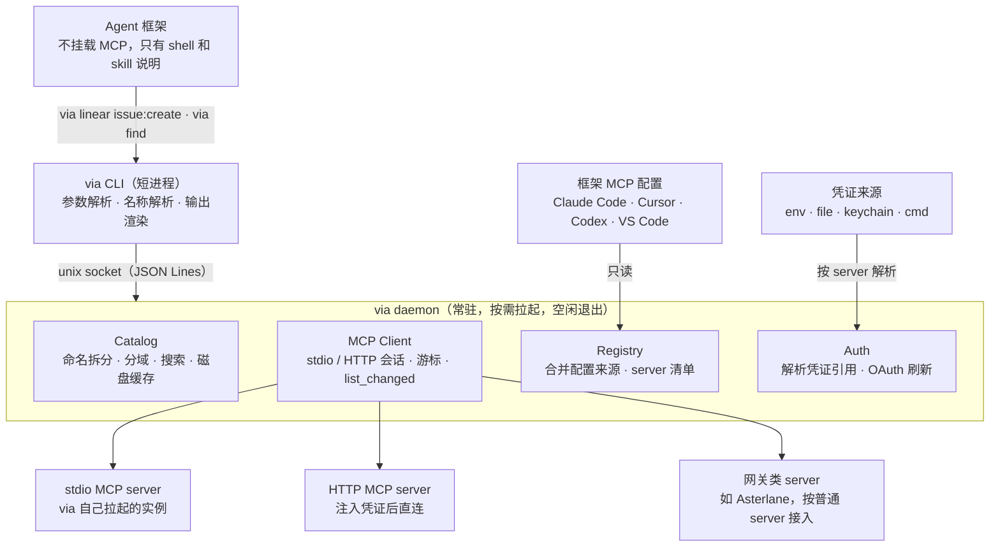

# 架构

via 分三层：短进程 CLI 负责解析和渲染，常驻 daemon 持有会话、目录和凭证，下游是各个 MCP server。agent 只和 CLI 打交道。

## 调用链路

1. agent 执行 `via …`。
2. CLI 解析子命令、工具引用和参数（[命令规范](../spec/cli.md)、[参数映射](../spec/arguments.md)）。
3. CLI 经 unix socket 把结构化请求交给 daemon；daemon 不存在时自动拉起（[daemon](../spec/daemon.md)）。
4. daemon 由 Registry 定位 server，Auth 注入凭证，MCP Client 发起调用。
5. 结构化结果返回 CLI，由 CLI 统一渲染（[输出](../spec/output.md)）。

框架配置只被读取，凭证只在 daemon 内存中解析。

## 组件职责

| 组件 | 职责 | 规范 |
| --- | --- | --- |
| CLI | 子命令分发、工具引用解析、schema 驱动的参数解析、渲染、退出码 | [cli](../spec/cli.md)、[arguments](../spec/arguments.md)、[output](../spec/output.md) |
| Registry | 探测并只读解析框架配置，合并用户与项目配置，产出 server 清单 | [config](../spec/config.md) |
| Auth | 解析凭证引用，执行 OAuth，刷新 token，脱敏 | [auth](../spec/auth.md)、[security](../spec/security.md) |
| MCP Client | 管理 stdio 子进程与 HTTP 会话，多路复用请求，订阅 `list_changed` | [daemon](../spec/daemon.md) |
| Catalog | 拉取与缓存 `tools/list`，拆分工具名，推断域，建索引，搜索 | [naming](../spec/naming.md)、[discovery](../spec/discovery.md) |

## 两种运行模式

| 模式 | 何时使用 | 特点 |
| --- | --- | --- |
| daemon 模式（默认） | 日常使用 | 会话复用、stdio server 常驻、游标保存在内存 |
| 进程内模式 | `VIA_NO_DAEMON=1`、CI、daemon 异常时的回退 | 每次调用直连；HTTP server 基本不受影响，stdio server 每次重新拉起 |

两种模式共用同一套请求与响应类型（见 [daemon 协议](../spec/daemon.md#cli-与-daemon-的协议)），渲染逻辑只有一份。
