# 路线图

先用 MVP 证明「不注入 schema、按需发现」既省 token 又不降低成功率；通过后再加 daemon 和 OAuth，最后做扩展。

## 当前状态（0.3.1）

0.1–0.3 的功能项除 c5（`via serve`，待定）外都已实现，并随 0.3.1 发布到 npm（`@modelctx-ai/via`）与 GitHub Release。两道门槛还没有正式过关：功能先于验证推进了，缺的证据列在[门槛](#门槛)里，补齐它们是 0.4 的第一件事。

```mermaid
flowchart LR
  subgraph v01["0.1 MVP：核心链路 ✅"]
    direction TB
    a1["HTTP 与 stdio 直连（进程内模式）"]
    a2["只读解析框架配置"]
    a3["凭证引用与注入（env / file / keychain）"]
    a4["三级浏览 · find · 调用"]
    a5["工具名拆分"]
    a6["统一渲染、游标、退出码"]
    a7["via doctor · via prompt"]
  end
  g1{{"门槛 1 ⏳"}}
  subgraph v02["0.2 常驻与鉴权 ✅"]
    direction TB
    b1["daemon 与会话复用"]
    b2["OAuth（PKCE、动态注册）"]
    b3["list_changed 实时刷新"]
    b4["via batch 与 cmd: 凭证"]
    b5["via trust 与 deny 规则"]
    b6["框架关闭提示数据文件"]
  end
  g2{{"门槛 2 ⏳"}}
  subgraph v03["0.3 扩展（c5 除外）✅"]
    direction TB
    c1["Bun 单文件可执行"]
    c2["可选语义检索"]
    c3["resources、prompts 与 roots"]
    c4["Windows 支持"]
    c5["via serve（待定）"]
  end
  subgraph v04["0.4 验证与打磨"]
    direction TB
    d1["发布 agent 评测结果"]
    d2["OAuth 实测记录"]
    d3["重新标定性能目标"]
    d4["单文件分发：签名、公证、目标平台实测"]
    d5["拆分规则与截断预算的实测调整"]
  end
  v01 --> g1 --> v02 --> g2 --> v03 --> v04
```

| 项 | 状态 | 说明 |
| --- | --- | --- |
| a1–a7 | 已实现 | |
| b1–b6 | 已实现 | |
| c1 Bun 单文件可执行 | 已实现 | `npm run build:bin`，发布见 `.github/workflows/release.yml`。Linux x64 完整验证；Linux arm64 与 macOS arm64 在发布流程里跑冒烟；Intel macOS、Windows、musl 只构建，未在目标机器上验证（[实现说明](development/implementation.md#单文件可执行)） |
| c2 可选语义检索 | 已实现 | 默认开启确定性的同义词扩展；embedding 检索由用户配置 `search.semantic` 开启，默认关闭（[ADR 0011](adr/0011-find-synonym-expansion-and-optional-embeddings.md)） |
| c3 resources、prompts 与 roots | 已实现 | [ADR 0010](adr/0010-mcp-resources-prompts-and-roots.md) |
| c4 Windows 支持 | 已实现 | daemon 走命名管道（[ADR 0012](adr/0012-windows-pipe-name-and-batch-files.md)），CI 在 Windows 上跑完整检查 |
| c5 `via serve` | 未开始 | 是否要做仍是[待定问题](open-questions.md)；决定做之前先写 ADR |

## 门槛

| 门槛 | 条件 | 状态 |
| --- | --- | --- |
| 门槛 1（0.1 → 0.2） | token 基准与 agent 评测跑通，任务成功率不低于原生 MCP，且不低于 mcp2cli | 未过关：token 基准已发布（[0.1](../bench/results/0.1.md)），agent 评测（`npm run bench:eval`）已实现但还没有发布成功率结果 |
| 门槛 2（0.2 → 0.3） | 热 daemon 调用开销达到[性能目标](development/testing.md#性能目标)，OAuth 在主流远程 server 上验证通过 | 部分达到：热 daemon 的额外开销远低于 15 ms；冷启动的几项和 daemon 内存在目标线上或略超（[perf-0.3-cold-start](../bench/results/perf-0.3-cold-start.md)）；OAuth 在真实远程 server 上的验证还没有记录 |

## 0.4：验证与打磨

0.4 不加新命令，先把 0.1–0.3 欠下的证据补齐，再按证据调整默认值。

- **d1 发布 agent 评测结果**：用 `npm run bench:eval` 在 token 基准的同一组任务上跑原生 MCP、via、mcp2cli 三组，结果写进 `bench/results/`。这是门槛 1 的条件，也是「省 token 不降成功率」的直接证据；结果不达标时先改拆分、浏览与渲染，而不是继续加功能。
- **d2 OAuth 实测记录**：在 Linear、Notion 等主流远程 server 上走一遍 `via auth login`、调用、刷新、`via auth logout`，记录到 `bench/results/` 或对应的 [provider 指南](guides/providers/)，补齐门槛 2。
- **d3 重新标定性能目标**：按 [perf-0.3-cold-start](../bench/results/perf-0.3-cold-start.md#目标重新标定的建议未改规范里的数字) 的建议，由维护者决定是否把冷启动改成相对 `node -e 0` 的增量、把 `find` 的库路径与整进程分开、daemon 内存改看匿名内存；决定后同步 [testing.md](development/testing.md#性能目标)。
- **d4 单文件分发**：macOS 公证与 Windows 签名；交叉编译产物在 Intel macOS、Windows、musl 上的实测；决定单文件是否成为默认推荐的安装方式（[待定问题](open-questions.md)）。
- **d5 拆分规则与截断预算**：在真实 server 上统计拆分失败（退回叶子工具）的比例、调整动词表；用 d1 的评测确定截断预算的默认值（现在是 8 KB）。动词表的改动按 CHANGELOG 的约定写明影响哪些规范写法。

c5（`via serve`）和其余[待定问题](open-questions.md)有结论后再排进路线图。

## 说明

- 0.1 没有 daemon，stdio server 每次调用都会重新拉起，评测时应以 HTTP server 为主，避免启动延迟干扰结论。
- 0.1 的游标保存在用户缓存目录。
- 0.1 中 OAuth 型 server 可以先用 bearer（如 Linear API key）验证链路。
