# 路线图

先用 MVP 证明「不注入 schema、按需发现」既省 token 又不降低成功率；通过后再加 daemon 和 OAuth，最后做扩展。

```mermaid
flowchart LR
  subgraph v01["0.1 MVP：核心链路"]
    direction TB
    a1["HTTP 与 stdio 直连（进程内模式）"]
    a2["只读解析框架配置"]
    a3["凭证引用与注入（env / file / keychain）"]
    a4["三级浏览 · find · 调用"]
    a5["工具名拆分"]
    a6["统一渲染、游标、退出码"]
    a7["via doctor · via prompt"]
  end
  g1{{"门槛 1"}}
  subgraph v02["0.2 常驻与鉴权"]
    direction TB
    b1["daemon 与会话复用"]
    b2["OAuth（PKCE、动态注册）"]
    b3["list_changed 实时刷新"]
    b4["via batch 与 cmd: 凭证"]
    b5["via trust 与 deny 规则"]
    b6["框架关闭提示数据文件"]
  end
  g2{{"门槛 2"}}
  subgraph v03["0.3 扩展"]
    direction TB
    c1["Bun 单文件可执行"]
    c2["可选语义检索"]
    c3["resources、prompts 与 roots"]
    c4["Windows 支持"]
    c5["via serve（待定）"]
  end
  v01 --> g1 --> v02 --> g2 --> v03
```

## 门槛

| 门槛 | 条件 |
| --- | --- |
| 门槛 1（0.1 → 0.2） | token 基准与 agent 评测跑通，任务成功率不低于原生 MCP，且不低于 mcp2cli |
| 门槛 2（0.2 → 0.3） | 热 daemon 调用开销达到[性能目标](development/testing.md#性能目标)，OAuth 在主流远程 server 上验证通过 |

## 说明

- 0.1 没有 daemon，stdio server 每次调用都会重新拉起，评测时应以 HTTP server 为主，避免启动延迟干扰结论。
- 0.1 的游标保存在用户缓存目录。
- 0.1 中 OAuth 型 server 可以先用 bearer（如 Linear API key）验证链路。
- 0.3 的 Bun 单文件可执行（c1）已实现（`npm run build:bin`，发布流程见 `.github/workflows/release.yml`）：Linux 上完整验证，其余平台的交叉编译产物在 CI 的 Linux/macOS 冒烟之外尚未在目标机器上验证，见[实现说明](development/implementation.md#单文件可执行)与[开放问题](open-questions.md)。
